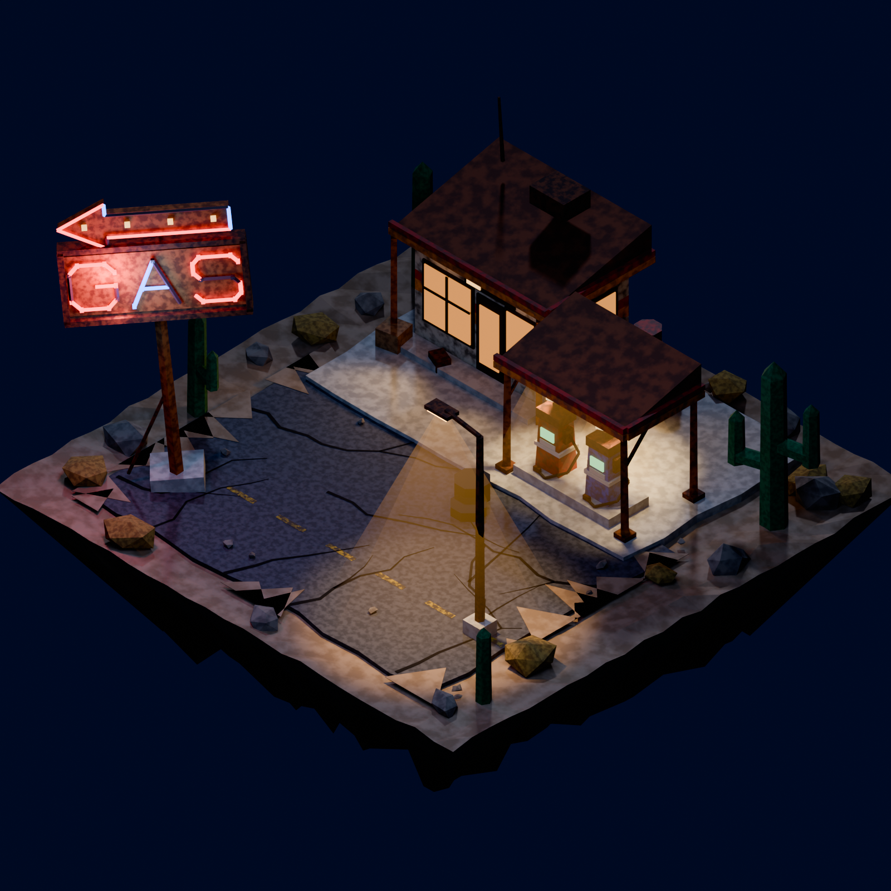

# Posto de Gasolina Retrô no Deserto

Diorama isométrico low poly noturno de um posto de gasolina retrô dos anos 60/70 no deserto, modelado **inteiramente por script Python no Blender** (sem texturas externas) e renderizado em Cycles.



## Modelo 3D no Sketchfab

**[Ver e girar o modelo no Sketchfab](https://sketchfab.com/3d-models/posto-de-gasolina-retro-no-deserto-23a904a2d9a843be8b88172e1da450e8)**

## O que tem na cena

- Loja com telhado em cunha, janelas âmbar e faixas laranja/vermelhas desgastadas
- Cobertura sobre duas bombas vintage (vermelha e azul) com globos luminosos
- Placa "GAS" torta e enferrujada, neon vermelho/azul com tubos apagados e seta retrô
- Asfalto rachado com areia invadindo as bordas, poste de luz com cone âmbar
- Cactos saguaro, arbustos secos, rochas angulares, barris, pneus e caixotes
- Bloco de terra flutuante em estratos

## Arquivos

| Arquivo | Descrição |
|---|---|
| `generate_posto_retro_lowpoly.py` | Gera toda a cena (malhas, materiais, luzes, câmera) e renderiza |
| `export_glb_textured.py` | Assa os materiais procedurais em texturas e exporta GLB (usado no Sketchfab) |
| `posto_retro_render.blend` | Cena pronta para abrir no Blender |
| `export/posto_retro.glb` | Modelo com texturas assadas |
| `docs/render.png` | Render final (1600 px, Cycles) |
| `docs/prompt.md` | Prompt original otimizado (EN), negativo e ideias de melhoria |

## Como usar

Requer Blender 5.x.

```bash
# gerar a cena e renderizar (caminho do PNG absoluto)
blender -b --python generate_posto_retro_lowpoly.py -- C:/caminho/saida.png 192 1600

# exportar GLB com texturas assadas
blender -b posto_retro_render.blend --python export_glb_textured.py -- C:/caminho/posto_retro.glb
```

Argumentos do gerador: `saida.png [amostras] [resolução] [CYCLES|EEVEE]`.

## Observações

- No Sketchfab, a iluminação é a do visualizador: ajuste o fundo escuro e o bloom para o neon brilhar. Os cones de luz volumétricos (falsos) não são exportados.
